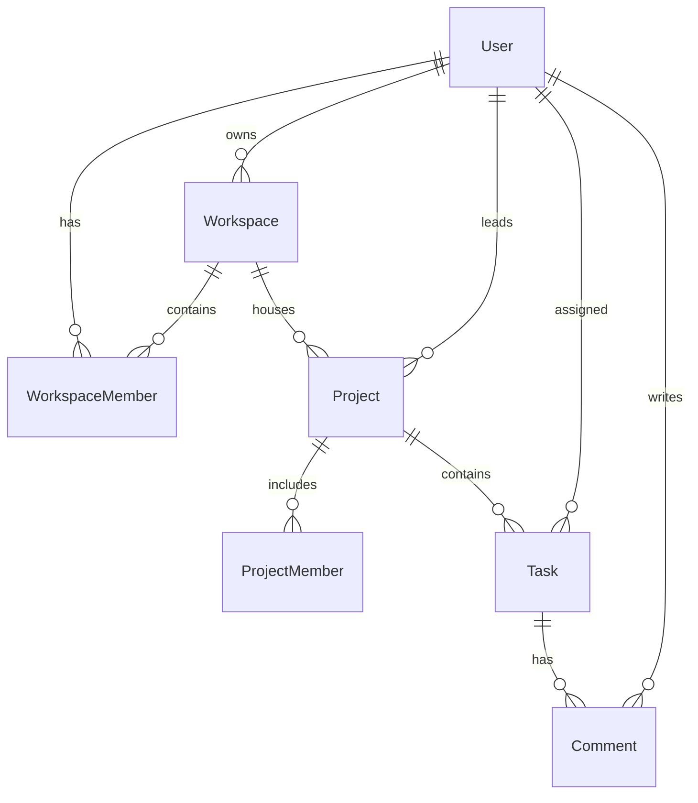

# 🚀 TaskSphere - Modern Full-Stack Project Management Platform

[](https://react.dev/)
[](https://vitejs.dev/)
[](https://tailwindcss.com/)
[](https://nodejs.org/)
[](https://www.prisma.io/)
[](https://neon.tech/)
[](https://clerk.com/)
[](https://www.inngest.com/)
[](https://projectmanagement-lovat-two.vercel.app/)

A modern, production-ready, full-stack multi-tenant project management platform. Designed for teams to plan, track, and collaborate on projects with ease—featuring organization-based workspaces, interactive Kanban & calendar views, comprehensive analytics, real-time background event synchronization, and automated email reminders.

> 🌐 **Live Demo**: [https://projectmanagement-lovat-two.vercel.app/](https://projectmanagement-lovat-two.vercel.app/)

---

## 🌟 Key Features

### 🏢 Multi-Tenant Workspaces & Clerk Organization Sync
- **Clerk Organizations Integration**: Seamless workspace switching and organization creation directly through Clerk.
- **Bi-Directional Auto-Sync**: Intelligent background sync and real-time reconciliation ensuring NeonDB and Clerk are always in sync.
- **Role-Based Access Control**: Granular `ADMIN` and `MEMBER` roles per workspace.
- **Smart Stale-Account Handling**: Resilient user conflict resolution preventing database duplicate key collisions.

### 📊 Project & Task Management
- **Project Workflows**: Create projects with custom priorities (`LOW`, `MEDIUM`, `HIGH`), statuses (`PLANNING`, `ACTIVE`, `COMPLETED`, `ON_HOLD`, `CANCELLED`), timelines, and team lead assignments.
- **Task Tracking**: Assign tasks, prioritize workload, classify by type (`TASK`, `BUG`, `FEATURE`, `IMPROVEMENT`), and monitor completion states (`TODO`, `IN_PROGRESS`, `DONE`).
- **Interactive Kanban & Views**: Board, list, and project overview screens for clear task status visibility.
- **Interactive Calendar View**: Timeline and due date tracking with date-fns integration.
- **Live Comments Thread**: Task discussions with author identification and timestamps.

### 📈 Analytics & Insights
- **Recharts Data Visualization**: Real-time project statistics, task completion rates, priority distributions, and member performance metrics.
- **Stats Dashboard**: High-level KPI summary cards for active projects, overdue tasks, and total members.

### ⚡ Event-Driven Automation (Inngest)
- **Background Event Pipelines**: Handles Clerk webhooks for instant user and organization lifecycle changes.
- **Automated Due-Date Reminders**: Step-based Inngest workflow that sleeps until task deadlines and checks if tasks remain incomplete.
- **Email Notifications**: Automated HTML reminder and task assignment emails delivered via Brevo (SMTP) and Nodemailer.

### 🎨 Modern UI & UX
- **Theme Switcher**: Dark mode and light mode support with Redux state persistence.
- **Micro-Animations & Modals**: Polished dropdowns, dialogs, smooth transitions, and feedback toasts via `react-hot-toast`.
- **Zero-Flicker Navigation**: Optimized loading states with stale-while-revalidate data fetching.

---

## 🏗️ Architecture & Tech Stack

### Frontend (`Client/`)
- **Core**: React 19, Vite 7
- **Styling**: Tailwind CSS v4
- **State Management**: Redux Toolkit (`workspaceSlice`, `themeSlice`)
- **Routing**: React Router DOM v7
- **Auth & Multi-Tenancy**: `@clerk/react`
- **Charts & Visuals**: Recharts, Lucide React
- **HTTP Client**: Axios

### Backend (`Server/`)
- **Runtime & Framework**: Node.js (ES Modules), Express 5
- **Database & ORM**: Neon Serverless PostgreSQL with `@prisma/adapter-neon` and Prisma ORM 6
- **Authentication**: `@clerk/express` middleware
- **Background Jobs**: Inngest v4
- **Mailing**: Nodemailer with SMTP (Brevo)
- **Deployment Ready**: Vercel Serverless Function architecture

---

## 🗄️ Database Schema Overview



* **User**: Clerk ID mapped, stores profile, email, name, avatar.
* **Workspace**: Organization details, slug, logo, ownership, and configuration.
* **WorkspaceMember**: Connects Users to Workspaces with `ADMIN` / `MEMBER` roles.
* **Project**: Tracks name, team lead, priority, status, dates, and progress.
* **ProjectMember**: Users assigned to specific projects.
* **Task**: Project tasks with type, priority, status, due date, and assignee.
* **Comment**: Comments attached to tasks.

---

## 📁 Repository Structure

```
Project_Management/
├── Client/                     # Frontend Application (Vite + React)
│   ├── src/
│   │   ├── app/                # Redux store configuration
│   │   ├── assets/             # Static assets and default placeholders
│   │   ├── components/         # Reusable UI components (Dialogs, Sidebar, Dropdown)
│   │   ├── configs/            # Axios API client instance
│   │   ├── features/           # Redux slices (workspaceSlice, themeSlice)
│   │   ├── pages/              # Main routes (Dashboard, Projects, Team, TaskDetails)
│   │   ├── App.jsx             # Route definitions
│   │   ├── main.jsx            # Application entry with Clerk & Redux providers
│   │   └── index.css           # Tailwind CSS directives
│   ├── package.json
│   └── vite.config.js
│
├── Server/                     # Backend API (Express + Prisma + Inngest)
│   ├── configs/                # Neon connection pool and Prisma client
│   ├── controllers/            # Request handlers (workspace, project, task, comment)
│   ├── inngest/                # Inngest event functions and background jobs
│   ├── middlewares/            # Clerk auth verification middleware
│   ├── prisma/                 # Prisma schema definition
│   ├── routes/                 # Express REST API routes
│   ├── server.js               # Application entry point
│   └── package.json
│
├── .gitignore
└── README.md
```

---
---

## 🚀 Getting Started Locally

### Prerequisites
* [Node.js](https://nodejs.org/) (v18.0.0 or higher)
* [npm](https://www.npmjs.com/) or [yarn](https://yarnpkg.com/)
* A free [Neon](https://neon.tech/) PostgreSQL database
* A free [Clerk](https://clerk.com/) account
* (Optional) An [Inngest](https://www.inngest.com/) account for background jobs

### 1. Clone Repository
```bash
git clone https://github.com/your-username/project-management.git
cd project-management
```

### 2. Setup Server
```bash
cd Server
npm install

# Push Prisma schema to NeonDB
npx prisma db push

# Generate Prisma Client
npx prisma generate

# Start Backend Dev Server
npm run server
```
Server starts on `http://localhost:5000`.

### 3. Setup Client
In a new terminal:
```bash
cd Client
npm install

# Start Vite Development Server
npm run dev
```
Client starts on `http://localhost:5173`.

### 4. (Optional) Run Inngest Dev Server Locally
To test background events and automated emails locally:
```bash
cd Server
npm run inngest
```
Open `http://localhost:8288` to inspect the Inngest local dashboard.

---

## 📡 REST API Reference

All protected endpoints require an `Authorization: Bearer <clerk_token>` header.

### Workspaces (`/api/workspaces`)
| Method | Endpoint | Description |
|---|---|---|
| `GET` | `/api/workspaces` | Fetch all workspaces for the authenticated user |
| `POST` | `/api/workspaces/add-member` | Add a new member to an existing workspace |

### Projects (`/api/projects`)
| Method | Endpoint | Description |
|---|---|---|
| `POST` | `/api/projects` | Create a new project |
| `GET` | `/api/projects/:id` | Get project details, members, tasks, and analytics |
| `PUT` | `/api/projects/:id` | Update project details, lead, dates, or progress |
| `DELETE` | `/api/projects/:id` | Delete a project |
| `POST` | `/api/projects/:id/members` | Add a member to a project |

### Tasks (`/api/tasks`)
| Method | Endpoint | Description |
|---|---|---|
| `POST` | `/api/tasks` | Create a task and schedule email assignment workflow |
| `PUT` | `/api/tasks/:id` | Update task status (`TODO`, `IN_PROGRESS`, `DONE`) or details |
| `DELETE` | `/api/tasks/:id` | Delete a task |

### Comments (`/api/comments`)
| Method | Endpoint | Description |
|---|---|---|
| `POST` | `/api/comments` | Post a comment on a task |
| `DELETE` | `/api/comments/:id` | Delete a comment |

---

## 🚢 Deployment

### 🌐 Live Production Application
- **Live URL**: [https://projectmanagement-lovat-two.vercel.app/](https://projectmanagement-lovat-two.vercel.app/)

### Deploy Backend (e.g. Vercel)
1. Import `Server/` as the project root in Vercel.
2. Add all `Server/.env` variables in Vercel Project Settings.
3. Configure the Clerk Webhook endpoint to `https://your-backend.vercel.app/api/inngest`.

### Deploy Frontend (e.g. Vercel)
1. Import `Client/` as the project root in Vercel.
2. Add `VITE_CLERK_PUBLISHABLE_KEY` and set `VITE_BASEURL` to your production backend URL.
3. Deploy!

---

## 🤝 Contributing

Contributions are welcome! Please follow these steps:
1. Fork the repository.
2. Create your branch (`git checkout -b feature/AmazingFeature`).
3. Commit your changes (`git commit -m 'Add some AmazingFeature'`).
4. Push to the branch (`git push origin feature/AmazingFeature`).
5. Open a Pull Request.

---

## 📄 License

This project is licensed under the **ISC License**. Feel free to use and adapt it for your team or organization!
